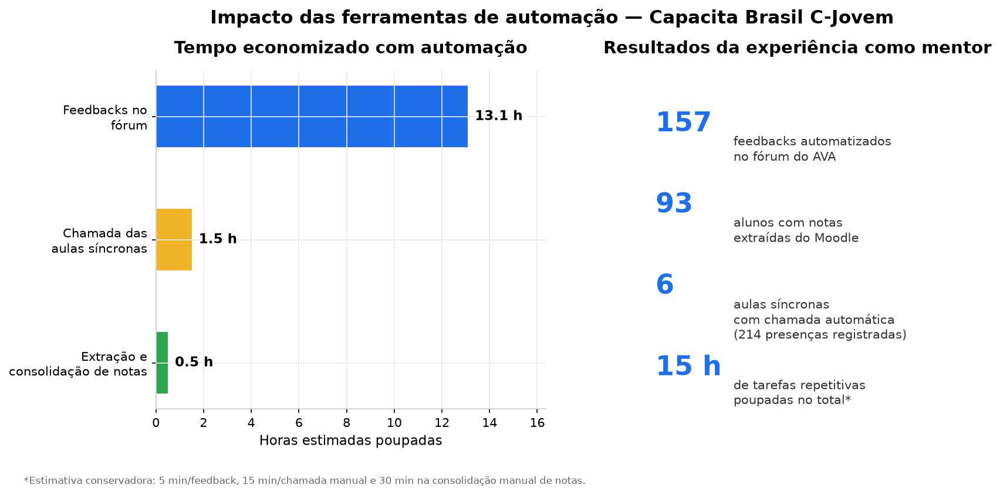
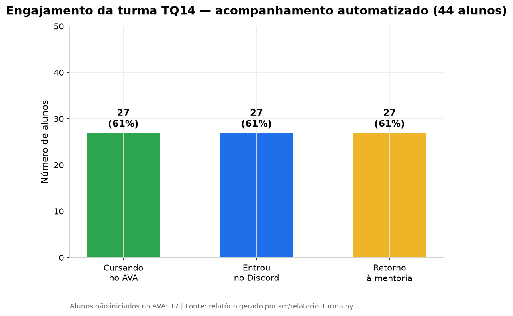
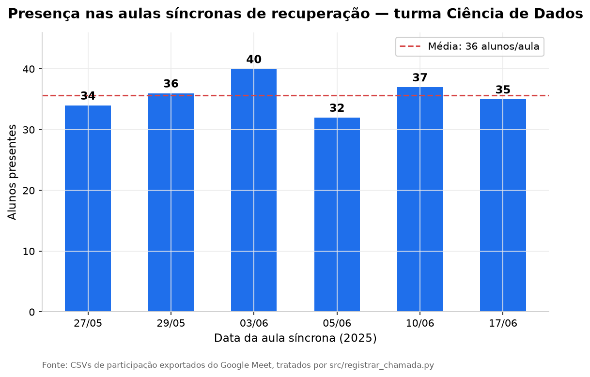
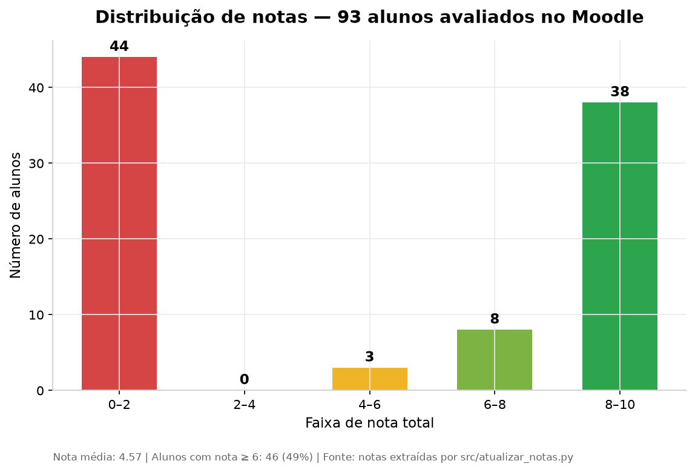

# C-Jovem — Automação de Mentoria | Capacita Brasil

Suíte de automações em Python criada durante a experiência como **mentor de Ciência de Dados (C-Jovem/Capacita Brasil)** para eliminar tarefas repetitivas do dia a dia: chamada nas aulas síncronas, avaliação de fóruns e oficinas, extração de notas, disparo de mensagens no Moodle/Discord/e-mail e geração de relatórios de acompanhamento da turma.

---

## Resultados da experiência

As ferramentas abaixo rodaram em produção durante o ciclo de recuperação da turma **TQ14 — Ciência de Dados** e geraram os resultados quantitativos que ilustram o impacto da automação:

### Impacto geral



| Métrica | Resultado |
|---|---|
| Feedbacks automáticos no fórum do AVA | **157** |
| Alunos com notas extraídas do Moodle | **93** |
| Aulas síncronas com chamada automática | **6** (214 presenças registradas) |
| Tempo estimado poupado em tarefas repetitivas | **~15 horas** |

### Engajamento da turma (acompanhamento automatizado)



O relatório automatizado permitiu identificar rapidamente os **17 alunos não iniciados** no AVA e direcionar o esforço de mentoria — 61% da turma permaneceu engajada no AVA, no Discord e retornando aos feedbacks.

### Presença nas aulas síncronas



A chamada, que antes era feita manualmente a partir dos CSVs do Google Meet, passou a ser importada direto no Moodle em minutos. Média de **36 alunos por aula** ao longo das 6 sessões de recuperação.

### Desempenho acadêmico



Notas extraídas automaticamente do relatório do Moodle e consolidadas na planilha de acompanhamento: **média 4,57** e **49% dos alunos com nota ≥ 6**.

> Todos os gráficos são regenerados a partir dos dados reais do projeto com:
> ```bash
> python scripts/gerar_graficos.py
> ```

---

## Estrutura do repositório

```
Cjovem/
├── .env                  # Credenciais (NÃO versionado — ver .gitignore)
├── .env.example          # Modelo das variáveis de ambiente
├── requirements.txt      # Dependências do projeto
├── src/                  # Scripts de automação
│   ├── config.py                 # Carrega o .env e centraliza caminhos/credenciais
│   ├── relatorio_turma.py        # Relatório de engajamento da turma (AVA + Discord)
│   ├── registrar_chamada.py      # Importa presença do Google Meet no Moodle via CSV
│   ├── atualizar_notas.py        # Extrai notas do Moodle e consolida na planilha
│   ├── avaliar_forum.py          # Avalia respostas do fórum com nota e feedback
│   ├── avaliar_oficinas.py       # Avalia envios de oficinas (tarefas) com feedback
│   ├── enviar_mensagem_moodle.py # Envia mensagens individuais no chat do Moodle
│   ├── criar_topico_forum.py     # Cria tópicos/avisos nos fóruns do AVA
│   ├── enviar_email_imersao.py   # Dispara e-mails em massa (lista em data/)
│   ├── discord_cd.py             # Automatiza envio de mensagens no Discord (pyautogui)
│   ├── discord_imersao.py        # Envia aviso de formulário no Discord da Imersão
│   ├── clicar_meet.py            # Bot de cliques/scroll no Google Meet
│   └── capturar_coordenadas.py   # Utilitário para capturar coordenadas de tela
├── data/                 # Dados de entrada e saída
│   ├── planilhas/        # CSVs do Meet e relatórios de status da turma
│   ├── notas_alunos.xlsx
│   ├── planilha_notas.xlsx / planilha_notas_atualizada.xlsx
│   ├── respostas_forum.txt
│   ├── destinatarios_imersao.txt          # (gitignored — pessoal)
│   └── *.example.txt                      # Modelos versionados
├── docs/
│   └── graficos/         # Gráficos de resultados gerados
├── scripts/
│   └── gerar_graficos.py # Gera todos os gráficos em docs/graficos/
└── output/               # Artefatos de execução (screenshots/debug, gitignored)
```

---

## Pré-requisitos

- **Python 3.10+** ([download](https://www.python.org/downloads/))
- **Google Chrome** atualizado (usado pelo Selenium)
- **Git** ([download](https://git-scm.com/downloads))
- Conta com acesso ao AVA Moodle da Capacita Brasil

---

## Como executar o projeto

### 1. Clonar o repositório

```bash
git clone https://github.com/seu-usuario/Cjovem.git
cd Cjovem
```

### 2. Criar e ativar o ambiente virtual

**Windows (PowerShell):**
```powershell
python -m venv venv
.\venv\Scripts\Activate.ps1
```

**Windows (CMD):**
```bat
python -m venv venv
venv\Scripts\activate.bat
```

**Linux/macOS:**
```bash
python3 -m venv venv
source venv/bin/activate
```

> Você saberá que o ambiente está ativo quando ver `(venv)` no início da linha de comando.

### 3. Instalar as dependências

```bash
pip install -r requirements.txt
```

### 4. Configurar as credenciais (`.env`)

O projeto **não tem credenciais no código**. Copie o modelo e preencha com seus dados:

```bash
# Windows
copy .env.example .env

# Linux/macOS
cp .env.example .env
```

Edite o `.env`:

```env
MOODLE_URL=https://capacitabrasil.moodlece.com.br/
MOODLE_USERNAME=seu_usuario
MOODLE_PASSWORD=sua_senha

EMAIL_REMETENTE=seu_email@exemplo.com
EMAIL_SENHA_APP=sua_senha_de_app_gmail
SMTP_HOST=smtp.gmail.com
SMTP_PORT=587
```

**Importante:**
- O arquivo `.env` está no `.gitignore` e **nunca será commitado**.
- Para o envio de e-mails via Gmail, gere uma **senha de aplicativo** em [myaccount.google.com/apppasswords](https://myaccount.google.com/apppasswords) (a senha normal não funciona com SMTP).
- Listas pessoais (destinatários de e-mail e alunos pendentes) ficam em `data/*.txt` — os arquivos `.example.txt` mostram o formato.

### 5. Executar os scripts

Sempre a partir da **raiz do projeto**, com o venv ativado:

| Script | O que faz | Comando |
|---|---|---|
| Relatório da turma | Gera `Status_Alunos_<TURMA>.xlsx` com engajamento no AVA/Discord | `python src/relatorio_turma.py` |
| Chamada automática | Trata os CSVs do Meet e importa a frequência no Moodle | `python src/registrar_chamada.py` |
| Extração de notas | Baixa as notas do Moodle e atualiza a planilha consolidada | `python src/atualizar_notas.py` |
| Avaliação de fórum | Nota 10 + feedback nas respostas do fórum (usa ChatGPT via clipboard) | `python src/avaliar_forum.py` |
| Avaliação de oficinas | Nota 10 + feedback nos envios das oficinas/tarefas | `python src/avaliar_oficinas.py` |
| Mensagem no Moodle | Envia mensagem para cada participante do curso | `python src/enviar_mensagem_moodle.py` |
| Tópico no fórum | Publica um aviso/lembrete como tópico novo no fórum | `python src/criar_topico_forum.py` |
| E-mail em massa | Envia e-mail para a lista de `data/destinatarios_imersao.txt` | `python src/enviar_email_imersao.py` |
| Aviso no Discord (Imersão) | Publica aviso de formulário nos chats da Imersão | `python src/discord_imersao.py` |
| Aviso no Discord (CD) | Publica lembrete de encontro nos chats da turma | `python src/discord_cd.py` |
| Cliques no Meet | Bot de scroll + cliques automáticos durante a aula | `python src/clicar_meet.py` |
| Capturar coordenadas | Auxilia a achar coordenadas (x, y) para os bots de tela | `python src/capturar_coordenadas.py` |
| Gerar gráficos | Regenera os gráficos em `docs/graficos/` | `python scripts/gerar_graficos.py` |

> **Nota sobre os scripts de tela (`pyautogui`):** `avaliar_forum.py`, `avaliar_oficinas.py`, `discord_cd.py` e `discord_imersao.py` automatizam a interface clicando em coordenadas fixas da tela. Execute-os com o **novo no monitor principal, na resolução usada no desenvolvimento**, e ajuste as coordenadas com `capturar_coordenadas.py` se necessário.

---

## Segurança

- **Nunca commite o `.env`.** Ele já está no `.gitignore`.
- **Credenciais antigas no histórico do git:** se este repositório já teve senha em texto nos arquivos (como aconteceu antes desta organização), **troque a senha do Moodle e gere uma nova senha de aplicativo no Gmail imediatamente** — remover o código do branch atual não apaga o histórico. Para limpar o histórico de forma completa, use [`git filter-repo`](https://github.com/newren/git-filter-repo) ou [BFG Repo-Cleaner](https://rtyley.github.io/bfg-repo-cleaner/).
- Os dados de alunos (nomes, e-mails, notas) presentes em `data/` são **dados pessoais** — trate o repositório como privado.

---

## Solução de problemas

**`Python was not found` / venv quebrado**
O `venv` precisa ser recriado na sua máquina:
```powershell
Remove-Item -Recurse -Force venv
python -m venv venv
.\venv\Scripts\Activate.ps1
pip install -r requirements.txt
```

**`A variável 'MOODLE_USERNAME' nao esta configurada`**
O `.env` não foi criado ou está vazio. Siga o passo 4 acima.

**Permissão negada ao ativar o venv (PowerShell)**
```powershell
Set-ExecutionPolicy RemoteSigned -Scope CurrentUser
```

**Erro de DLL do numpy (`DLL load failed`)**
A versão está fixada em `numpy==2.2.6` no `requirements.txt` devido a políticas de controle de aplicativo do Windows. Reinstale:
```bash
pip install numpy==2.2.6 --force-reinstall
```

**Selenium não encontra o Chrome**
Instale o [ChromeDriver](https://chromedriver.chromium.org/) compatível com a versão do seu Chrome, ou use o Selenium Manager (automático no Selenium 4.6+).

**Conflitos no `git pull`**
Resolva os conflitos nos arquivos marcados e depois:
```bash
git add .
git commit -m "Resolvendo conflitos"
git push
```

---

## Fluxo de trabalho com Git

```bash
git checkout main
git pull origin main

git checkout -b minha-feature
# ... alterações ...
git add .
git commit -m "Descrição das alterações"
git push origin minha-feature
```

Crie um Pull Request no GitHub para mesclar com `main`.
